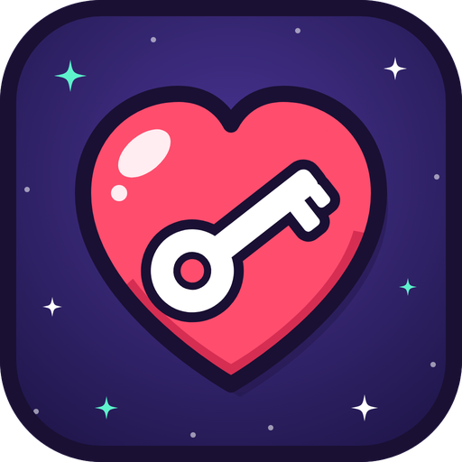

# FreeKeep<3 : jeux gratuits à vie & vrais bons plans, à ta mesure



Extension Chrome / Opera GX / Edge / Brave (Manifest V3) organisée en quatre sections.

| Section | Contenu |
|---|---|
| 🎁 **Gratuits** | Jeux PC offerts à garder à vie : Epic, Steam, GOG, Ubisoft, EA, Battle.net, Microsoft Store, **Amazon Prime** (Amazon Games, Legacy Games, Luna), **et les drops ponctuels** (Alienware Arena, Fanatical, Humble Bundle, IndieGala, itch.io…) |
| 💻 **Promos PC** | Les jeux que les joueurs **achètent en ce moment**, récents et bien notés, au **meilleur prix** sur 30+ stores. Les vieux jeux et les petites promos attendent derrière « Voir tout » |
| 📚 **Bundles** | Les meilleurs packs : Humble Bundle · Fanatical + Green Man Gaming + Digiphile · bundles de tes stores (Steam, GOG) · indie sans DRM (itch.io + IndieGala) |
| 🎮 **Switch** | Grosses promos **eShop** (jeux jouables sur Switch 1), **jeux en boîte** (Amazon, Fnac, Leclerc…) et **clés** |

## Installation

1. Dézippe l'archive. Range le dossier quelque part de fixe, par exemple `Documents\FreeKeep` : le navigateur le relit à chaque démarrage.
2. Ouvre `chrome://extensions` (ou `opera://extensions`, `edge://extensions`).
3. Active le **Mode développeur**.
4. Clique sur **Charger l'extension non empaquetée** et choisis le dossier **`extension/`**.
5. Épingle l'icône ❤️ (le cœur).

**Accès aux sites** : à l'installation, seuls Epic et Steam sont demandés. Les autres le sont pendant le tutoriel, selon tes choix, et tu peux refuser : la source correspondante est alors simplement ignorée. GamerPower et Barter.vg sont ouverts à tous, sans accès à donner.

**Mise à jour** : le popup prévient quand GitHub a une version plus récente (une lecture par jour du numéro de version, désactivable). Remplace alors le contenu du dossier `extension/`, puis clique sur ↻ (Recharger) sur la carte FreeKeep<3. Ton historique est conservé.

**Sauvegarde** : Réglages → Sources & données → Exporter / Importer (réglages, jeux récupérés, éléments masqués), pour un autre PC ou une réinstallation. L'import ajoute sans rien effacer. La clé GG.deals n'est ni exportée ni synchronisée : elle reste sur ton ordinateur.

## Personnalisation

**Tutoriel au premier lancement**, relançable depuis Réglages → « Relancer le tutoriel ». Une **flèche** guide tout : elle glisse d'une catégorie à la suivante (chacune s'ouvre quand elle arrive, celles d'avant restent modifiables), puis montre le bouton « Continuer ». Jamais de minuteur : elle passe à la suite quand ta réponse est complète (Oui / Non cliqué, ou tout coché), quand ton curseur descend sur la catégorie suivante ou sur le bouton, ou quand tu cliques « Suite ». Impossible de sauter une catégorie : elle ne s'ouvre que si celles d'avant sont remplies. Elle ne remonte jamais : une réponse modifiée plus haut la laisse où elle est. Quitté en route, il reprend où tu en étais. Entrée continue, et les animations se coupent si ton système le demande. Il a 9 pages avec l'accueil, certaines n'apparaissent que si elles te concernent :

1. **Plateformes** : PC, Switch, et « je veux aussi les jeux Switch 2 ».
2. **Stores PC** où tu actives tes jeux : Steam, Epic Games, GOG, EA app, Ubisoft Connect, Battle.net, Microsoft Store, itch.io, IndieGala, Autres. Puis **Bundles** (oui / non, puis quels sites). Puis **Amazon Prime** (oui / non, puis où) : Amazon Games, Legacy Games, Luna (cloud).
3. **Ce que tu veux voir** : jeux gratuits, promos PC, promos Switch, jeux en boîte (+ ton département), sites de clés, bundles. Puis **l'accès aux sites** utiles à ces choix.
4. **Niveau d'exigence** : 🔥 que les affaires de fou, ⚖️ équilibré ou 🌊 large, avec le nombre d'annonces montrées d'abord pour chacun.
5. **Tes bibliothèques** : lecture de tes jeux Steam et GOG via les sessions déjà ouvertes dans ton navigateur (lien de profil Steam facultatif). Les promos sur tes jeux sont masquées et ta liste de souhaits Steam est mise en avant.
6. **Ce que tu ne veux pas voir** (avec des conseils : nombre d'annonces que chaque filtre retirerait, genres et licences absents de ta bibliothèque Steam) : 16 genres à masquer (horreur, sport, hentai…) et des licences à bannir (LEGO, Mortal Kombat, Hogwarts Legacy…). Les orthographes proches et les variantes (« Hogwart's Legacy », « NBA 2K26 », « EA FC 27 ») sont reconnues.
7. **Alertes** : notifications, fréquence, clic automatique.
8. **Récapitulatif**.

**Filtres du popup** : deux lignes qui se combinent. Promos PC : **tes launchers** (Steam, Epic, GOG, Ubisoft…), puis Top, Souhaits, Clés. Bundles : par site, puis Les meilleurs, Moins de 10 €, Contient un souhait. Switch : Switch / Switch 2, puis eShop, Physique, Clés. Un jeu vendu sur plusieurs launchers affiche le prix de celui que tu as choisi. Tes launchers restent affichés même à 0.

**Pas de doublons** : un jeu vu par plusieurs sources n'a qu'une carte (« Part 2 » = « Part II », éditions, ponctuation…). La carte montre l'offre la moins chère et « Aussi : » les autres.

**Menus adaptatifs** : le popup n'affiche que tes sections. Il n'y a pas de barre de sections s'il n'y en a qu'une, pas de filtre Switch 2 si tu ne l'as pas choisi, et pas d'onglet « Bientôt » sans Epic. Les éléments masqués par tes filtres restent consultables (« 🚫 N masqués par tes filtres »), avec la raison du masquage.

**Réglages en 6 onglets** : Mes plateformes (+ Amazon Prime) · Ce que je veux voir · Filtres · Mes bibliothèques · Alertes · Sources & données.

### Bibliothèque Steam : via ta session, sans mot de passe

- Steam ne montre plus la liste des jeux d'un profil sans connexion, même s'il est public. FreeKeep<3 lit donc tes jeux et ta liste de souhaits via ta session `store.steampowered.com`, si tu es déjà connecté dans ce navigateur. Aucun identifiant n'est demandé ni enregistré. Désactivable dans les réglages.
- **Lien de profil (facultatif)** : sans session ouverte, il permet de lire ta liste de souhaits si elle est publique. Avec une session, « Vérifier » affiche le nombre de jeux possédés reconnus.
- **Annonces Dealabs** : elles n'ont pas d'identifiant Steam. FreeKeep<3 le retrouve par le nom du jeu (10 recherches par vérification), pour masquer aussi ceux que tu possèdes.
- Ce que ça change :
  - les promos sur les jeux que tu possèdes sont masquées, sur Steam comme sur les autres launchers ;
  - un jeu de ta liste de souhaits Steam n'est proposé que sur Steam ;
  - les jeux gratuits Steam que tu as déjà sont cochés « récupérés » ;
  - les jeux de ta liste de souhaits remontent en tête dès -20 %, et une alerte part dès -50 %.
- La bibliothèque se resynchronise toutes les 12 h (toutes les heures si tu n'étais pas connecté), ou avec le bouton « Synchroniser ».

### Bibliothèque GOG : via ta session, sans mot de passe

- Si tu es déjà connecté à gog.com dans ton navigateur, FreeKeep<3 lit ta liste de jeux GOG (`gog.com/userData.json` puis `account/getFilteredProducts`). Aucun identifiant n'est demandé ni enregistré.
- Ce que ça change : les promos sur ces jeux sont masquées (correspondance stricte du nom), et les jeux gratuits GOG que tu as déjà sont cochés « récupérés ».
- Pas connecté ? La carte GOG des réglages l'indique ; connecte-toi sur gog.com puis clique « Synchroniser ». Désactivable à tout moment.

**Autres plateformes** : Epic, Ubisoft, EA, Battle.net, Microsoft Store et Amazon ne publient pas de bibliothèque lisible sans te connecter à ton compte. FreeKeep<3 note donc un jeu comme possédé quand sa page affiche « Dans la bibliothèque », ou quand tu cliques « Je l'ai ».

### Amazon Prime (ex-Prime Gaming)

- Coche « J'ai Amazon Prime » pour voir les jeux offerts aux abonnés. Sans Prime, ils restent cachés : tu ne pourrais pas les récupérer.
- Les jeux Prime à activer sur **Epic**, **GOG** ou le **Microsoft Store** suivent tes choix de stores. Les autres vont dans **Amazon Games** (l'application d'Amazon), **Legacy Games** (codes) ou **Luna** (jeux en cloud, à jouer en streaming : pas à garder, donc ni comptés dans le badge ni ouverts par « Tout récupérer »).
- Sans Prime, le popup indique seulement combien de jeux tu manques.
- Chaque jeu Prime porte le badge 👑 Prime. Sur Dealabs, il est reconnu par le titre, le magasin, le lien Amazon ou la description.

### Switch / Switch 2

Chaque bon plan Switch est classé **Switch** (jouable sur Switch 1, et donc aussi sur Switch 2) ou **Switch 2** (exclusif). Le classement s'appuie sur les codes Nintendo (HAC = Switch 1, BEE = Switch 2) et sur les titres Dealabs. Les jeux Switch 2 n'apparaissent que si tu les as demandés.

### Genres

- Les genres viennent des principaux tags et des avertissements de contenu Steam, lus par lots : tout est filtré dès la première vérification. Pour la Switch, des catégories de l'eShop Nintendo.
- **Hentai / sexe explicite** : seul l'avertissement Steam « contenu sexuel réservé aux adultes » compte, plus les tags Hentai et NSFW. Les jeux violents ou PEGI 18 (GTA, Red Dead, Call of Duty…) et ceux avec de la nudité (The Witcher 3, Cyberpunk 2077…) restent visibles.
- Pour les jeux sans données (Epic, Dealabs…), FreeKeep se base sur le titre.
- La liste de souhaits ignore le filtre de genres, mais pas les mots-clés bannis.

## Vérifications automatiques

- Les vérifications interrogent les vrais sites. Elles tournent en arrière-plan, même popup fermé, tant que le navigateur est ouvert.
- **Fréquence** : toutes les 15 min par défaut, réglable de 5 min à 24 h (5 à 15 min conseillé pour les erreurs de prix). Aucune notification n'est envoyée pendant le tutoriel ; s'il est abandonné depuis 30 min, tes réponses s'appliquent et les alertes démarrent. Une vérification se lance aussi :
  - à l'installation ;
  - au démarrage du navigateur ;
  - à l'ouverture du popup si la dernière date de plus de 30 min.
- **Réglages → État des sources** : chaque source y est affichée en direct (✔ nombre de résultats ou ✘ erreur), avec l'heure de la prochaine vérification et un bouton « Vérifier maintenant ».
- Pour ne pas se faire bloquer par les API, chaque source garde ses résultats un minimum de temps : environ 15 min pour CheapShark, l'eShop et (lors des vérifications automatiques) Epic, Steam et GamerPower, 4 min pour Dealabs, 50 min pour GG.deals.
- **Source en panne** : elle est rappelée de moins en moins souvent (10 min, 20, 40… puis toutes les 6 h). Ses derniers prix restent affichés 24 h au plus, avec leur âge. Une source qui tombe d'un coup à zéro est signalée, et son ancien résultat gardé.

## 🎁 Gratuits

- Sources : API officielle Epic, recherche Steam (-100 %), catalogue GOG (jeux passés à 0 €), [LootScraper](https://feed.eikowagenknecht.com/lootscraper/) (Amazon Prime, GOG, Ubisoft, Humble, itch.io), [GamerPower](https://www.gamerpower.com), qui recense les giveaways de jeux PC (dont Prime), et les jeux offerts postés sur [Dealabs](https://www.dealabs.com) (Prime, Microsoft Store, Battle.net…). Les week-ends gratuits, démos, free-to-play, DLC, jeux mobiles, bonus de stream (Twitch Drops…) et packs de contenu sont écartés.
- Le site qui organise le giveaway est affiché, par exemple « via Alienware Arena ». Ces sites demandent parfois un compte.
- Le bouton **Récupérer** ouvre la page du store et détecte l'ajout à ta bibliothèque (Epic, Steam, GOG, Ubisoft, itch.io, IndieGala). Le **clic automatique** sur « Obtenir » est *expérimental* et désactivé par défaut : il n'agit que sur la page du jeu demandé, jamais sur un autre jeu ouvert dans le même onglet. Sur Epic, la commande n'est validée que si le total est à 0 €. Les captchas restent à faire toi-même.
- Les jeux que tu possèdes déjà sont détectés : sur Steam et GOG via ta session, sur les stores quand la page affiche « Dans la bibliothèque ».

## 💻 Promos PC : les jeux voulus, au meilleur prix

**Sélection** : chaque section montre d'abord ses meilleures annonces (30 PC, 20 Switch, 10 bundles en « Équilibré » ; deux fois moins en « Que les affaires de fou », deux fois plus en « Large »). Le reste attend derrière **Voir tout**, avec la raison affichée (🕰️ vieux jeu, 👎 peu ou mal noté, ❔ peu demandé, 💤 petite remise, 🗳️ peu voté).

- **Ce qui compte** : ce que les joueurs achètent (meilleures ventes Steam en promo, votes Dealabs, téléchargements eShop), la note Steam, l'âge du jeu, puis la remise et le plus bas historique.
- **Vieux jeux** : au-delà de 6 ans (4 ou 10 selon le niveau, réglable), un jeu passe après, sauf s'il est dans ta liste de souhaits, très plébiscité sur Dealabs ou en erreur de prix.
- **Remise selon l'âge** : un jeu sorti cette année n'est jamais à −60 %. Il suffit de −27 % la première année, −33 % la deuxième, −48 % jusqu'à 4 ans (niveau Équilibré).
- **Ménage** : pas de DLC ni d'extensions ; une seule carte par jeu, clés comprises (le store officiel reste devant, la clé est indiquée) ; titres Dealabs raccourcis au nom du jeu, sauf prix sous condition.
- **Prix d'un revendeur** (GameBillet, Fanatical, GMG…) : sa remise est appliquée au vrai prix Steam en euros, plus juste qu'une conversion du dollar.

| Source | Ce qu'elle apporte |
|---|---|
| [GOG](https://www.gog.com) | Catalogue officiel, en euros, jeux notés 4/5 et plus |
| EA | Offres du site EA, en euros |
| Bundles | Humble Bundle, Fanatical, Green Man Gaming, Digiphile : contenu via [Barter.vg](https://barter.vg), gardés s'ils ont au moins 3 jeux bien notés sur Steam (2 à 6 selon le niveau). Steam et GOG : remise d'au moins 60 à 85 % sur la valeur du contenu selon le niveau. IndieGala : au moins 4 jeux et 70 à 85 % d'avis positifs en moyenne (clés Steam). [itch.io](https://itch.io/bundles) : lots de 4 jeux et plus à 2,50 € le jeu maximum (pas de note disponible) |
| Steam | Meilleures ventes en promo (les jeux voulus), prix officiels en euros, note, date de sortie, promos de ta liste de souhaits |
| [CheapShark](https://www.cheapshark.com) | Promos sur 30+ stores officiels (Steam, GOG, Humble, Fanatical, GMG, Gamesplanet, Battle.net…), avec la note Metacritic et les avis Steam |
| [Dealabs](https://www.dealabs.com) | Deals **hot** validés par la communauté, y compris sur les sites de clés (Eneba, Instant Gaming, G2A…), et **erreurs de prix** (avec le groupe « erreur de prix ») |
| [GG.deals](https://gg.deals) *(facultatif)* | Prix des **sites de clés** en euros, plus bas historiques, surveillance des gros jeux |

Ce qui est gardé (seuils réglables) :
- **Gros jeu** : vendu 29 $ ou plus, Metacritic 75+ ou avis Steam 80 %+, remise d'au moins 60 %.
- **💎 Pépite** : avis Steam 90 %+ (3 000 avis minimum), remise d'au moins 70 %.

Badges : ⚠️ erreur de prix · 📉 chute soudaine (-30 % depuis la vérif précédente) · 🏆 plus bas historique · 🔥 hot Dealabs · 🔑 prix sur les sites de clés.

**Activer les sites de clés** : crée un compte gratuit sur gg.deals, puis Settings → API → copie ta clé dans les réglages de FreeKeep. FreeKeep surveille alors les prix « clé » de ~60 gros jeux populaires et des promos en cours. Il te prévient si un prix chute brutalement.

## 🎮 Switch

- **eShop** : moteur de recherche officiel de Nintendo Europe, plus l'API de prix Nintendo pour le prix exact en € et la date de fin. Ne sont gardés que les jeux bien classés dans les téléchargements Nintendo : top 500, ou top 1 500 s'ils sont vendus 20 € et plus. Les jeux Nintendo sont gardés dès -20 %. Les jeux inconnus bradés à -90 % sont écartés, et les jeux réservés à la Switch 2 aussi, sauf si tu les as demandés. Si seul le pack ou l'édition Deluxe est en promo, c'est son prix qui s'affiche, avec la mention « pack ou Deluxe ».
- **Physique** : jeux en boîte postés sur Dealabs (Amazon, Fnac, Leclerc, Micromania…), nationaux et locaux à égalité. Les pages Dealabs donnent la température, le prix de référence et les offres encore valables des 30 derniers jours ; le RSS ajoute les toutes dernières.
- **Clés** : Eneba, Kinguin et Instant Gaming (Europe), comparés au prix de l'eShop, plus les deals Dealabs. Les comptes partagés, cartes prépayées et DLC sont écartés.
- **Tri** : Les accessoires et consoles sont écartés, et les jeux uniquement Switch 2 aussi, sauf si tu les as demandés. Les promos valables dans un seul magasin ne sont gardées que pour les départements que tu indiques (aucun par défaut ; numéros ou code postal).

## Notifications

- Nouveau jeu gratuit, et rappel quand il reste moins de 24 h.
- **Affaires exceptionnelles** : erreur de prix, chute soudaine, plus bas historique à -75 % et plus, deal hot à -60 % et plus, jeu Nintendo à -40 % et plus.

## Structure

```
extension/
├── background.js              # service worker : vérifs, notifs, badge, messages
├── src/
│   ├── config.js              # stores, sites, réglages par défaut
│   ├── merge.js               # fusion des jeux gratuits
│   ├── deals.js               # fusion des bons plans, chutes de prix, score, « exceptionnel »
│   ├── refresh-deals.js       # récupération des sources avec cache (ménage les API)
│   ├── titles.js                  # comparaison des titres (doublons), la même partout
│   ├── selection.js           # ce qui est montré d'abord : envie, note, âge, prix
│   ├── levels.js, keywords.js, recommend.js  # niveaux, licences bannies, conseils du tutoriel
│   ├── health.js, access.js, claim.js        # pannes, accès aux sites, page du bon jeu
│   ├── backup.js, update.js                  # sauvegarde, nouvelle version
│   ├── store.js, util.js
│   └── sources/
│       ├── epic.js, steam.js, gamerpower.js      # gratuits
│       ├── cheapshark.js, ggdeals.js             # promos PC
│       ├── eshop.js                              # promos Switch
│       ├── dealabs.js                            # boîtes, clés, erreurs de prix, jeux offerts (RSS)
│       ├── dealabspages.js                       # température, prix de référence, offres récentes
│       ├── gog.js, ea.js                         # promos officielles en euros
│       ├── bundles.js, storebundles.js           # Humble, Fanatical… ; Steam, GOG, itch.io
│       ├── switchkeys.js                         # clés Switch (Eneba, Kinguin, Instant Gaming)
│       ├── steamstore.js, rates.js               # prix Steam en euros, taux BCE
│       └── goglibrary.js                         # jeux GOG via la session gog.com
├── src/prefs.js, src/genres.js            # personnalisation : sections, exclusions, jeux possédés
├── src/sources/steamlibrary.js, steamapps.js, steamsearch.js  # bibliothèque/souhaits, fiches (genres, note, âge), recherche par nom
├── src/sources/wanted.js      # meilleures ventes Steam en promo, meilleur prix sur 30+ stores
├── onboarding/                # tutoriel : steps.js (questions), flow.js (ordre), guide.js (flèches)
├── ui/                        # composants partagés (tutoriel + réglages)
├── content/claim.js           # clic assisté + détection « possédé »
├── popup/  options/  icons/
tests/
├── fixtures.js                # données calquées sur le format réel des API
├── unit.test.js               # 89 tests
├── background.test.js         # 23 tests : service worker dans un navigateur simulé
└── e2e/edge.mjs               # essai complet dans un vrai Edge, profil jetable
```

## Tests

```bash
npm test            # tests unitaires, aussi lancés par GitHub à chaque envoi
npm run test:edge   # tutoriel, réglages et popup dans un vrai Edge (Windows)
```

Une partie des tests reprend des réponses relevées sur les vrais sites en novembre 2026.

Une version précédente (0.3) a aussi été testée de bout en bout dans Chrome (36 vérifications), avec de fausses versions de toutes les API et pages des stores. Ces tests ne prouvent pas que les vrais sites répondent comme prévu. Les scénarios couverts :

- installation et tutoriel complet ;
- bibliothèque et liste de souhaits Steam, bibliothèque GOG via la session ;
- jeux Prime (Epic, Amazon Games, Legacy), Battle.net et Microsoft Store, Luna cloud ignoré si non coché ;
- filtres de genres et de mots-clés, tri Switch / Switch 2 ;
- menus qui s'adaptent quand on décoche une plateforme ;
- fusion des sources et tri des bons plans ;
- erreurs de prix, chute soudaine sur un site de clés, notifications ;
- filtres et masquage dans le popup ;
- récupération assistée (Steam, Epic, GOG) et sécurité sur le total Epic.

## Limites connues

- **Prix en euros** : exacts pour Steam, GOG, EA, l'eShop, les clés Switch, les bundles et Dealabs. CheapShark (Epic, Ubisoft, revendeurs) et GamerPower ne donnent que des dollars : la remise est appliquée au prix Steam en euros quand il est connu, sinon le prix est converti au taux de la Banque centrale européenne. Dans les deux cas, il est précédé de « ≈ ».
- **Bundles** : le prix n'est pas connu pour Digiphile et certains Fanatical. Seul le contenu est comparé.
- **G2A** bloque les lectures automatiques : ses offres n'apparaissent que si elles sont postées sur Dealabs.
- **Clés PC** : sans clé API GG.deals, seules celles postées sur Dealabs sont vues.
- **Dealabs** : les flux par groupe ne donnent pas la température (le flux « Hot » la met en tête du titre, FreeKeep<3 la retire). FreeKeep s'appuie donc sur le flux « Hot » officiel et garde un historique de 14 jours. Un deal peut avoir expiré même s'il est encore listé.
- Dealabs, CheapShark, Nintendo et GG.deals peuvent changer leurs API. Si une source tombe, un bandeau le signale, l'État des sources passe en ✘ et les dernières données connues restent affichées, 24 h au plus.
- Navigateur fermé = pas de vérification : la suivante se fait au redémarrage.
- Les sites de clés sont du marché gris : prix plus bas, mais pas de garantie éditeur.
- **Amazon Prime n'a pas d'API publique** (la page des jeux Luna est générée en JavaScript). Les jeux Prime sont repérés via LootScraper, GamerPower et Dealabs : il peut en manquer, surtout les jeux Luna en cloud.
- **Steam** : une annonce Dealabs au titre ambigu (édition inconnue, lot de jeux) n'est pas reconnue, donc pas masquée si tu possèdes le jeu.
- **Launchers** : Battle.net et le Microsoft Store n'ont pas de source publique. Pour eux, seules les annonces Dealabs comptent, donc souvent peu de promos.
- **Récupération itch.io et IndieGala** : reconnue d'après les textes de leurs pages, pas encore essayée avec un compte connecté.
- **GOG** : `getFilteredProducts` n'est pas une API documentée ; GOG peut la changer. En cas d'échec, la carte GOG passe en ⚠️ et le reste fonctionne.

---

Données : Epic Games Store, Steam, GOG, [GamerPower](https://www.gamerpower.com), [CheapShark](https://www.cheapshark.com), Nintendo eShop, [Dealabs](https://www.dealabs.com), [GG.deals](https://gg.deals). FreeKeep<3 n'est affilié à aucun de ces services.
